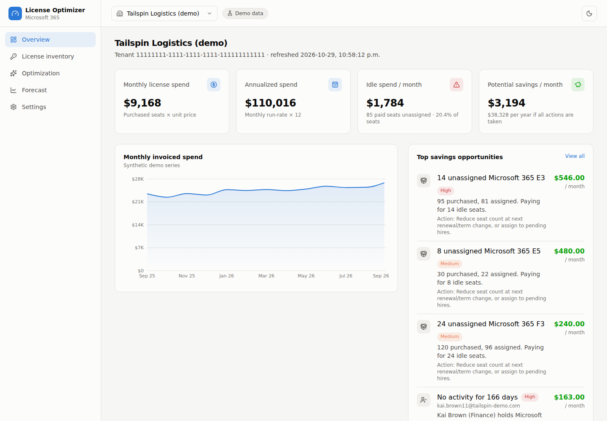
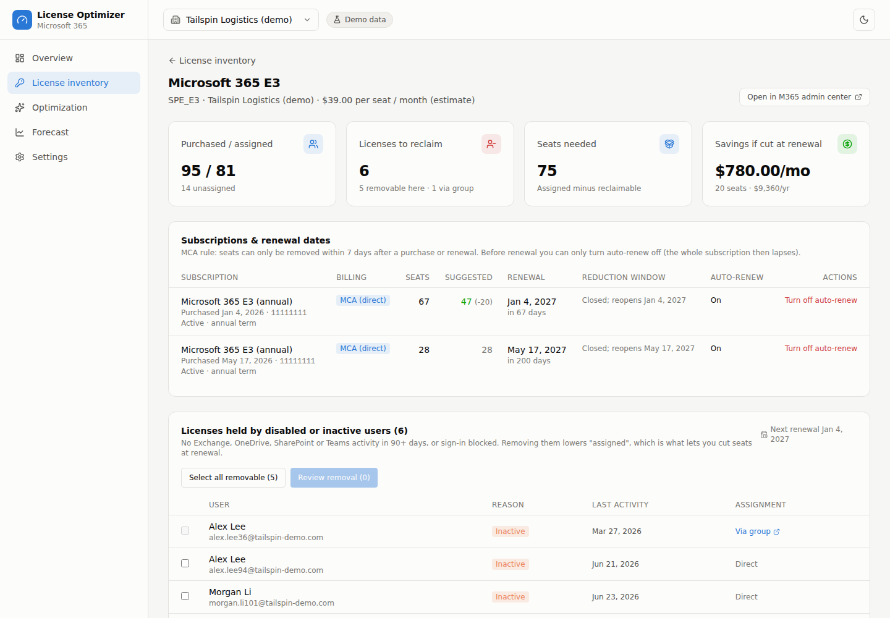
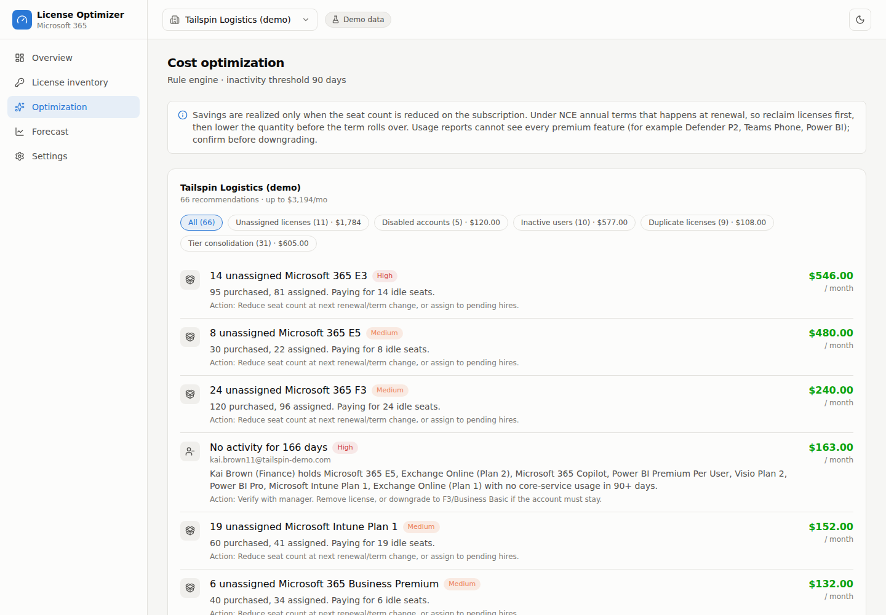
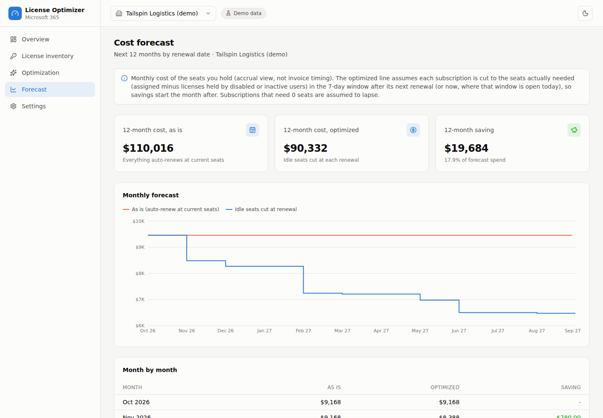
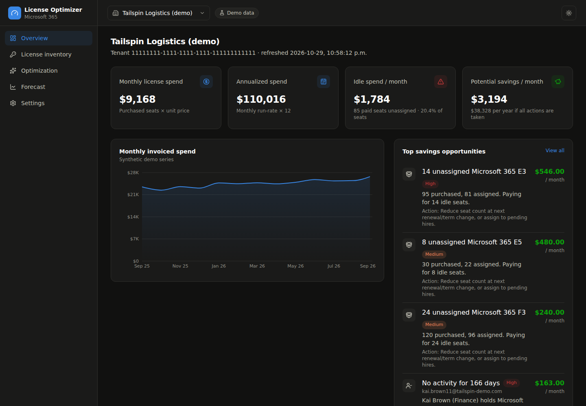
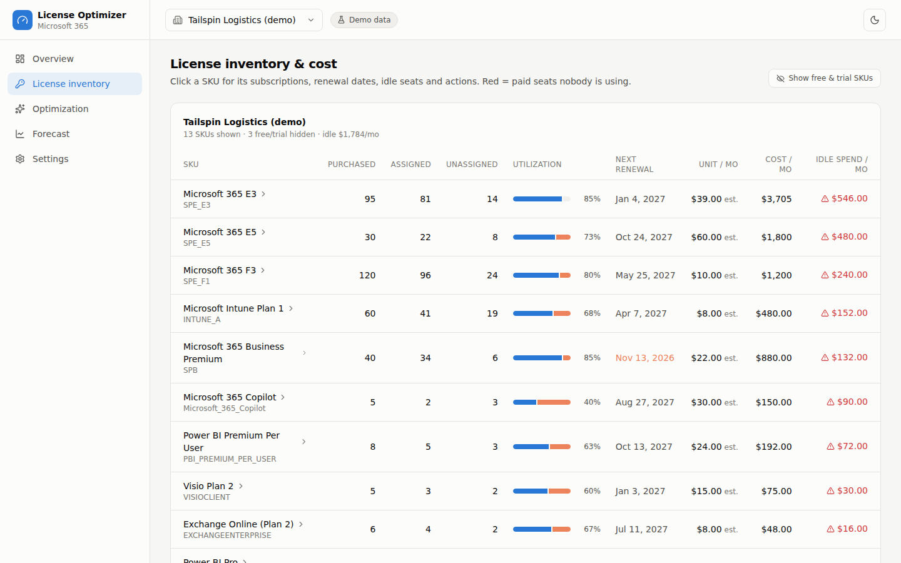
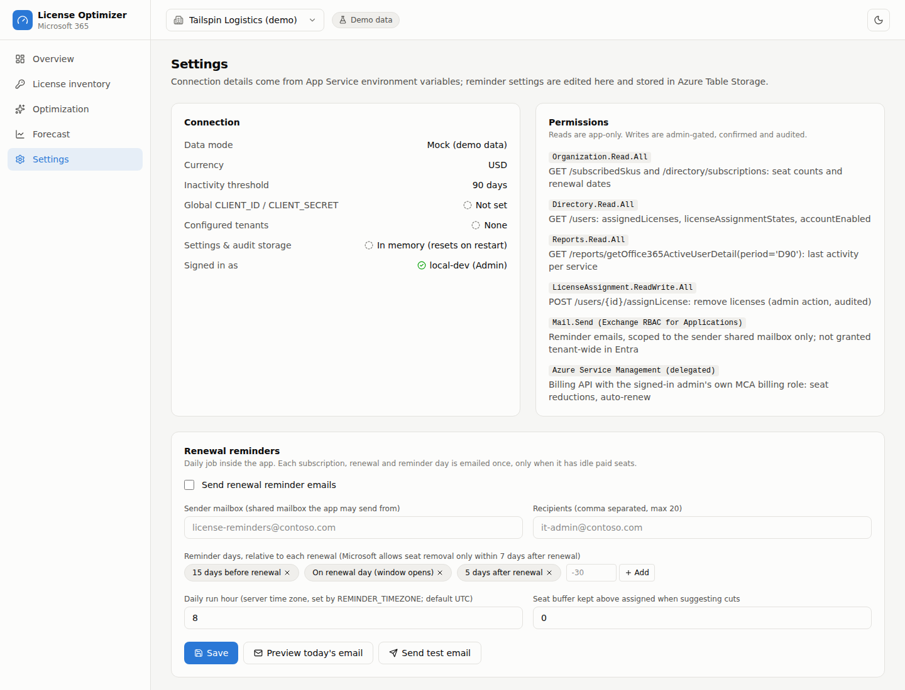

# M365 License Optimizer

A self-hosted dashboard that finds idle Microsoft 365 licenses, forecasts what you would save, and reminds you when the window to remove seats opens. It reads your tenant through Microsoft Graph, runs in your own Azure subscription, and can deploy itself with a guided setup wizard.



- **Find waste:** unassigned seats, disabled accounts, inactive users, duplicate licenses and tier-consolidation candidates, with the estimated monthly saving for each.
- **Know your renewal windows:** next renewal date and reduction window per subscription, a 12-month cost forecast ("as is" versus "idle seats cut at each renewal"), and daily-job reminder emails.
- **Act safely (optional):** remove licenses from disabled or inactive users, reduce seats and switch auto-renew for Microsoft Customer Agreement subscriptions. Every action is previewed, confirmed, validated on the server and written to an audit log.
- **One tenant or many:** switch tenants in the top bar or view a combined overview.
- **Demo mode:** runs with synthetic data and no Microsoft calls, so you can look around before connecting anything.

> **Status:** v1.0. Built and run in production for a single organization, then generalized for sharing. Read the [limitations](#limitations-and-disclaimer) before trusting any dollar figure.

<details>
<summary>More screenshots (synthetic demo data)</summary>

| | |
|---|---|
|  |  |
|  |  |
|  |  |

</details>

## Quick start (demo, 2 minutes)

```bash
git clone https://github.com/rajibkumardas/m365-license-optimizer.git
cd m365-license-optimizer
npm install
cp .env.example .env.local      # leave DATA_MODE=mock
npm run dev                     # http://localhost:3000
```

Mock mode never calls Microsoft APIs. Use `DEV_ROLE=admin` in `.env.local` to see the admin-only action buttons locally.

## Deploy to your own Azure subscription (setup wizard)

Open **Azure Cloud Shell (Bash)** in the Azure portal, clone this repository and run the wizard:

```bash
git clone https://github.com/rajibkumardas/m365-license-optimizer.git
cd m365-license-optimizer
./setup.sh
```

The wizard asks for your organization's values, shows a summary, saves them to `~/.licopt.env` (no secrets) and then offers to run the deployment:

| Prompt | What it controls |
|---|---|
| Organization name | Tenant label shown in the dashboard |
| Display currency | ISO code used to show costs (USD, CAD, EUR, GBP...) |
| Inactivity window | Days without Exchange, OneDrive, SharePoint or Teams activity before a user counts as inactive |
| Azure region, resource group, unique suffix | Where the resources go and the globally unique names (`app-licopt-<suffix>`, `acrlicopt<suffix>`, `kv-licopt-<suffix>`, `stlicopt<suffix>`) |
| App Service plan size | B1 is enough for most tenants; Basic or higher is needed for Always On |
| Access groups | Entra groups for read-only users and for admins (created if missing) |
| Reminder emails (optional) | Shared mailbox that sends reminders and the time zone for the daily run |

Non-interactive use for automation: copy `deploy/example.conf`, edit it, then run `./setup.sh --config my.conf --yes --phases all`. `./setup.sh --help` lists every option.

### What the deployment creates

| Phase | Creates or changes |
|---|---|
| `preflight` | Nothing. Checks tools, sign-in and your Azure and Entra roles |
| `infra` | Resource group, container registry (image built in the registry, no local Docker), Linux App Service plan, Web App with managed identity and `AcrPull`, health check. Starts in **mock mode** |
| `auth` | Sign-in app registration, read-only users group, "assignment required", App Service Authentication |
| `graph` | Graph Reader app registration with `Organization.Read.All`, `Directory.Read.All`, `Reports.Read.All` (consent granted for you), Key Vault with the client secret (never printed), then switches the app to **live** data |
| `upgrade` | Storage account for settings, audit log and reminder ledger (shared keys disabled, managed identity), `LicenseAssignment.ReadWrite.All`, admin and reader app roles, admins group, billing sign-in scope, Always On, reminder settings |
| `image` | Code-only rebuild and switch. Roll back by re-running with a previous `NEW_TAG` |
| `status` / `rollback` | Print current settings / print (never run) the removal commands |

Run phases individually with `./deploy/deploy.sh <phase>`; they are idempotent.

### Permissions you need

- **Azure:** Owner, or Contributor plus User Access Administrator, on the subscription (the script creates role assignments).
- **Entra ID:** Global Administrator, or Privileged Role Administrator, **active** during the `auth`, `graph` and `upgrade` phases (activate it in PIM if you are eligible). Assigning a group to the sign-in app needs **Entra ID P1** or higher.
- **Exchange Online:** Exchange Administrator, only if you enable reminder emails.
- **Billing actions (optional):** the signed-in admin needs a billing role on a Microsoft Customer Agreement billing account. Subscriptions bought through a partner (CSP) are visible in the dashboard but get reminders only, not billing actions.

### Reminder emails (optional)

Reminders are sent with Graph `sendMail` from one shared mailbox. Instead of granting `Mail.Send` in Entra ID (which allows sending as any mailbox), the app uses Exchange Online RBAC for Applications scoped to that single mailbox:

```powershell
# In Azure Cloud Shell, PowerShell; Exchange Administrator. The upgrade phase prints this command with your values.
pwsh -NoProfile -Command 'Connect-ExchangeOnline -Device; ./deploy/Set-MailSendScope.ps1 -AppId <graph-app-id> -ServicePrincipalObjectId <sp-object-id> -Mailbox license-reminders@contoso.com'
```

Do **not** also grant `Mail.Send` in Entra ID: Entra and Exchange grants combine and would undo the restriction. Then sign out and back in once, open **Settings** and enable reminders. The daily job needs **Always On**.

## How it works

Graph returns seats and users; it returns **no prices or invoices**, so cost comes from a price book you can override.

| Data | Source |
|---|---|
| Purchased and assigned seats | `GET /subscribedSkus` (`prepaidUnits.enabled`, `consumedUnits`) |
| Renewal dates, trial and status | `GET /directory/subscriptions` |
| Users, assigned licenses, group-assigned flags | `GET /users` |
| Activity | `getOffice365ActiveUserDetail(period='D90')` usage report |
| Billing terms and actions (MCA only) | Azure Billing API with the signed-in admin's own token |

Optimization rules run in priority order per user (disabled, then inactive, then duplicate or downgrade), so a user is never double counted:

| Rule | Signal |
|---|---|
| Unassigned licenses | Seats purchased minus seats assigned on a paid SKU |
| Disabled accounts | `accountEnabled = false` with paid licenses |
| Inactive users | No activity in the inactivity window (users missing from the usage report are "unknown", never "inactive") |
| Duplicate licenses | A SKU already included in another SKU the user holds |
| Tier consolidation | Active on mail and Teams only: E5 to E3, E3 to F3, Business Premium or Standard to Basic, Exchange Plan 2 to Plan 1 |

Savings are **potential**: money is saved only when seats are reduced on the subscription.

### Microsoft rules the app is built around

| Rule | What the app does |
|---|---|
| On Microsoft Customer Agreement subscriptions, seats can only be **removed within 7 days after a purchase or renewal** | Shows each reduction window and enables **Reduce seats** only while it is open |
| Turning **auto-renew Off** ends the **whole** subscription at term end | Separate action that requires typing the SKU part number |
| The billing API `cancel` call is Partner Agreement only | Not used; partner-billed subscriptions get reminders and an admin center link |
| Group-assigned licenses cannot be removed per user | Shown as "Via group" with an Entra link; refused on the server |
| Intune Plan 1 Device is a tenant pool and is never "assigned" | Shown with a pool badge; excluded from idle spend and actions |

Verify these against Microsoft Learn for your agreement type; Microsoft changes licensing rules often.

## Pricing

`lib/pricing/priceBook.ts` ships **estimates**: public Microsoft list prices in USD per user per month on an annual commitment (Business and Enterprise plans as announced for July 2026, the rest approximate). Your agreement, currency, tax, partner margin and monthly-billing premium will differ.

Override without editing code, keyed by `skuPartNumber` (find yours with `Get-MgSubscribedSku | Select SkuPartNumber, SkuId`):

```bash
PRICE_OVERRIDES='{"SPE_E3":39,"SPE_E5":60,"O365_BUSINESS_PREMIUM":14}'
```

Overridden prices are labeled "override" in the UI, and estimates are labeled "estimate". Set `CURRENCY` to match the currency of the prices you enter.

## Configuration reference

| Variable | Required | Description |
|---|---|---|
| `DATA_MODE` | yes | `mock` or `live` |
| `AZURE_TENANT_ID` | live, single tenant | Directory (tenant) ID |
| `CLIENT_ID` / `CLIENT_SECRET` | live | Graph Reader app registration. Keep the secret in Key Vault and use a Key Vault reference |
| `TENANT_DISPLAY_NAME` | no | Label for the single tenant |
| `TENANTS` | live, multi-tenant | JSON array `[{"id":"contoso","name":"Contoso","tenantId":"<guid>"}]`; optional per-tenant `clientId` and `clientSecret`. Overrides `AZURE_TENANT_ID` |
| `CURRENCY` | no | ISO code for display, default `USD` |
| `INACTIVITY_DAYS` | no | Default `90` |
| `PRICE_OVERRIDES` | no | JSON of monthly unit prices keyed by `skuPartNumber` |
| `STORAGE_ACCOUNT_NAME` | v2 features | Table Storage for settings, audit log and reminder ledger (managed identity, no keys) |
| `ENABLE_SCHEDULER` | no | `true` to run the daily reminder job (needs Always On) |
| `REMINDER_SENDER` | no | Default sender mailbox shown in Settings |
| `REMINDER_TIMEZONE` | no | IANA time zone for the daily run hour, default `UTC` |
| `APP_BASE_URL` | no | Links used in reminder emails |
| `EASY_AUTH_ENABLED` | live | Set to `true` by the deploy script after it verifies App Service Authentication is on. In live mode the app trusts sign-in headers only when this is `true` |
| `BILLING_ACCOUNT_NAME` | no | Pin one Microsoft Customer Agreement billing account if you can see several |
| `DEV_ROLE` | dev only | `admin` or `reader`, simulates the role locally |

Secrets are read only on the server (`lib/config.ts` is `server-only`); the browser never receives them.

### Multi-tenant (for MSPs and groups of companies)

Set `TENANTS` and either a multi-tenant app registration consented in each customer tenant, or per-tenant `clientId` and `clientSecret`. Tenant selection is URL state (`?tenant=<id>`).

### Graph prerequisites

- Application permissions on the Graph Reader app: `Organization.Read.All`, `Directory.Read.All`, `Reports.Read.All` (and `LicenseAssignment.ReadWrite.All` only if you use the remove-license action).
- In the Microsoft 365 admin center, **Settings > Org settings > Reports**: turn **off** "Display concealed user, group, and site names in all reports". Otherwise the usage report is hashed and inactive-user detection is disabled (the app detects this and warns).

## Security notes

- Keep App Service Authentication on and restrict the sign-in app to your groups. The dashboard shows user principal names and activity.
- Prefer a certificate or federated credential over a client secret in production. Secrets created by the wizard last one year; set a reminder to rotate them.
- Write paths: license removal (app-only, admin role required), billing changes (delegated, limited by the admin's own billing role), `Mail.Send` scoped to one mailbox. Every change is audited.
- If you ever turn App Service Authentication off, also set `EASY_AUTH_ENABLED=false`; otherwise sign-in headers could be forged.
- To report a vulnerability, see [SECURITY.md](SECURITY.md).

## Project layout

See [docs/architecture.md](docs/architecture.md) for the file structure and design rules. Stack: Next.js 15 (App Router), React 19, TypeScript, Tailwind CSS v4, Recharts, Azure Table Storage, deployed as a container to Azure App Service.

## Limitations and disclaimer

- **Dollar figures are estimates.** There is no invoice data in Graph; cost uses the price book. Confirm against your invoices before quoting a saving.
- The billing join (matching Graph subscriptions to billing subscriptions by tenant, product, end date and quantity) is heuristic. Ambiguous matches stay unmatched and billing actions are refused rather than guessed.
- Usage reports cannot see E5-only features (Defender P2, Teams Phone, Power BI Pro, Purview). E5 downgrade suggestions say "confirm first".
- Some third-party or add-on SKUs do not appear in Graph at all.
- Removing licenses or reducing seats affects real users and real billing. Try everything in mock mode first, and review the preview before confirming.
- This is an independent open-source project, not affiliated with or endorsed by Microsoft. Microsoft 365, Azure, Entra and related names are trademarks of Microsoft Corporation. The software is provided as is, without warranty (see [LICENSE](LICENSE)).

## Roadmap

- Invoice history in live mode (Azure Cost Management or CSV import)
- `signInActivity` as an extra inactivity signal (needs `AuditLog.Read.All` and Entra ID P1)
- Export recommendations to CSV or Excel
- Service-plan-level overlap detection from `servicePlans`
- Bicep or Terraform alternative to the shell deployment

## Contributing and license

Issues and pull requests are welcome; see [CONTRIBUTING.md](CONTRIBUTING.md). Released under the [MIT License](LICENSE).
